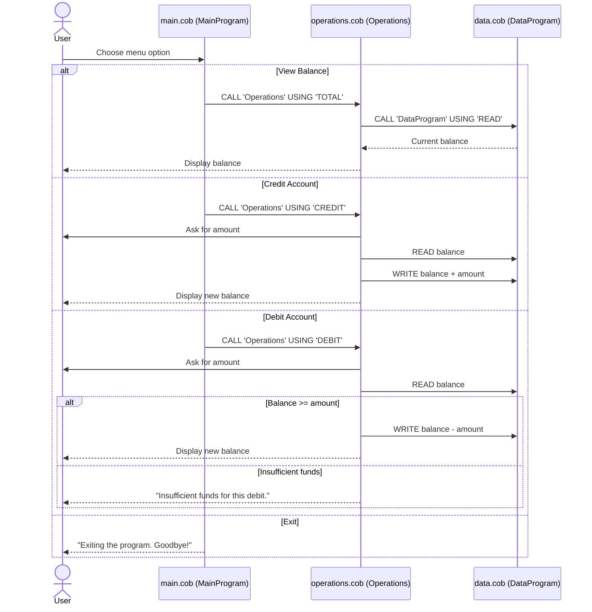

# Student Account Management System (COBOL)

This legacy COBOL application manages a single student account balance. Users can view the balance, credit the account, and debit the account from a simple text menu.

## COBOL Files

### `main.cob` — MainProgram
- Entry point of the application.
- Shows the menu in a loop: **1. View Balance**, **2. Credit Account**, **3. Debit Account**, **4. Exit**.
- Reads the user's choice and calls `Operations` with `TOTAL`, `CREDIT`, or `DEBIT`.
- Stops when the user chooses **4** (sets `CONTINUE-FLAG` to `NO`). Invalid choices show an error message.

### `operations.cob` — Operations
- Performs the requested business operation.
- `TOTAL`: reads the balance from `DataProgram` and displays it.
- `CREDIT`: asks for an amount, reads the balance, adds the amount, and writes the new balance.
- `DEBIT`: asks for an amount, reads the balance, and only subtracts it if the balance is large enough; otherwise shows **"Insufficient funds for this debit."**

### `data.cob` — DataProgram
- Acts as the data storage layer.
- Keeps the balance in `STORAGE-BALANCE` (starts at **1000.00**).
- `READ` copies the stored balance to the caller; `WRITE` saves the caller's balance.

## Business Rules
- The starting balance is **1000.00**.
- Amounts use the format `PIC 9(6)V99` (up to 999,999.99, no negative values).
- A debit is rejected if it would make the balance negative.
- The balance is kept only in memory while the program runs.

## Data Flow

